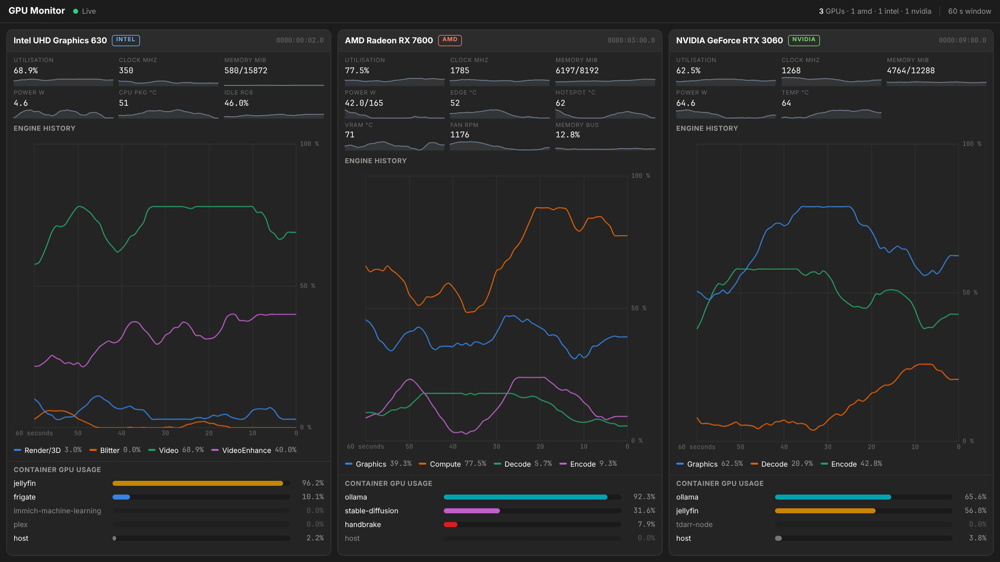
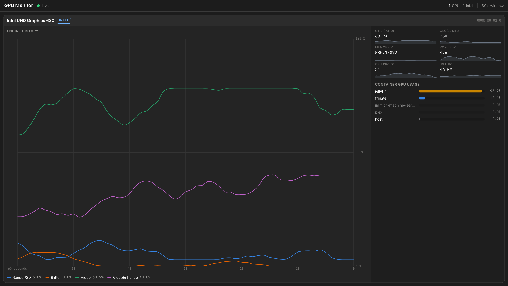

# gpu-monitor

[](LICENSE)
[](https://github.com/dean1850/gpu-monitor/pkgs/container/gpu-monitor)

**A self-hosted, real-time GPU dashboard that tells you *which container* is
using the GPU — not just that something is.**

Intel, AMD and NVIDIA, concurrently, on the same host — every card on one
screen, no scrolling. Dark mode, modelled on GNOME System Monitor's
Resources tab.



---

## About

Every GPU monitoring tool for Linux answers "how busy is the GPU?". Almost
none answer the question you actually have on a homelab box: **who is using
it right now?**

If Jellyfin, Frigate, Immich and Ollama all share one card, `intel_gpu_top`
tells you the video engine is at 60% and leaves you to guess which of the
four is responsible. `nvidia-smi` gives you PIDs, but those PIDs are
meaningless from outside the container that owns them.

gpu-monitor closes that gap. It reads the GPU's engine counters straight from
the kernel, walks `/proc/<pid>/fdinfo` for every process on the host holding a
DRM render-node file descriptor, and maps each PID back through the Docker
socket to the container that owns it. The result is a live percentage
breakdown per container, per engine, per GPU.

Some specifics that shaped the design:

- **Per-engine, not one number.** A GPU isn't one thing. An Intel iGPU has
  Render/3D, Blitter, Video and VideoEnhance, and a QSV transcode lights up
  the last two while leaving the first two idle. Collapsing that into a single
  "GPU: 34%" throws away the part that tells you what's actually happening.
  Every engine the card exposes gets its own line, in that card's own
  terminology — Intel's Render/3D and VideoEnhance, AMD's Graphics and
  Compute, NVIDIA's Encode and Decode.
- **Mixed vendors are a first-class case,** not a bolt-on. An iGPU handling
  transcodes alongside a discrete card doing inference is an ordinary homelab
  arrangement. Each GPU gets its own panel with a coloured vendor badge, its
  own engine chart, and its own container breakdown, so it's obvious at a
  glance which card is doing the work.
- **It fits on the screen.** Three GPUs side by side with no scrollbar from
  1280x800 upward: one column per GPU, each with stat tiles (clock, VRAM,
  power, every temperature sensor, fan, RC6 idle) carrying their own sparklines over the chart
  window. One GPU gets a full-height plot with a stats sidebar instead, two
  get two columns, more than three add columns until they'd fall below 330px
  and then wrap to a second row — shedding sparklines and shortening the
  container list as cards get shorter. A phone scrolls normally.
- **Colours you can actually tell apart.** The engine palette is Adwaita
  stepped for a dark surface and checked against simulated protanopia and
  deuteranopia, not chosen by eye: worst adjacent pair OKLab dE 8.6, every
  line clearing 3:1 contrast on the card. `tools/screenshots.mjs` regenerates
  the screenshots above and asserts the no-scroll promise across twelve
  viewport-and-GPU-count combinations.
- **No fabricated numbers.** An Intel iGPU has no VRAM and no sensors of its
  own in i915, so its Power, Temperature and Memory come from what the
  hardware really has: the CPU's RAPL GPU plane, the CPU package sensor
  (labelled **CPU pkg**, since the iGPU shares that die), and the shared RAM
  its DRM clients hold. Where a host doesn't expose a source — RAPL and the
  package sensor are usually missing inside a VM — the tile renders `—`,
  never a plausible-looking zero.
- **No shelling out.** No `intel_gpu_top`, no `nvidia-smi` subprocess, no
  vendor Python packages. Metrics come from `perf_event_open(2)`, sysfs,
  `/proc`, and NVML through `ctypes`. The whole thing is stdlib plus FastAPI.
- **Degrades instead of dying.** A backend that can't find its hardware
  returns an empty list. A backend that breaks mid-run reports a reason
  through `/health` while the others keep sampling. With no GPU at all, the
  app still starts and tells you why it found nothing.

Built for a LAN-only homelab host. Read the [security model](#security-model)
before putting it anywhere else — it needs real privileges to do what it does.

---

## Quick start

No clone, no build — the image is published to GitHub Container Registry.

```bash
mkdir gpu-monitor && cd gpu-monitor

curl -O https://raw.githubusercontent.com/dean1850/gpu-monitor/main/docker-compose.yml
curl -o .env https://raw.githubusercontent.com/dean1850/gpu-monitor/main/.env.example

docker compose up -d
```

Open **`http://<your-host>:8088`**.

That's the whole install. With the default `auto` vendor switches, whatever
GPUs the host actually has show up and the rest stay silent — no inventory
step, no per-vendor setup, with one exception: **NVIDIA needs host-side
toolkit setup first**, covered [below](#nvidia-setup).

```bash
docker logs gpu-monitor          # one line per backend probe result
curl -s localhost:8088/health | python3 -m json.tool
```

Then put load on the GPU — start a transcode, run an inference job — and
watch the relevant engine line climb with the responsible container named
underneath it.

**→ [QUICKSTART.md](QUICKSTART.md)** covers every setting, NVIDIA host setup,
updating, reduced-privilege mode, troubleshooting, and building from source.

---

## Configuration

Everything lives in **`.env`**, next to `docker-compose.yml`. Compose reads it
automatically and passes it through, so you never edit the compose file. It is
git-ignored, so your settings never end up in a commit.

| Variable | Default | Meaning |
|---|---|---|
| `TZ` | `UTC` | Any IANA name, e.g. `Europe/Berlin`. Affects displayed clock times only |
| `GPU_ENABLE_INTEL` | `auto` | `auto` \| `true` \| `false` |
| `GPU_ENABLE_AMD` | `auto` | `auto` \| `true` \| `false` |
| `GPU_ENABLE_NVIDIA` | `auto` | `auto` \| `true` \| `false` |
| `GPU_MONITOR_PORT` | `8088` | Host port for the dashboard |
| `DOCKER_RUNTIME` | `runc` | `nvidia` on [NVIDIA hosts](#nvidia-setup) |
| `NVIDIA_VISIBLE_DEVICES` | `void` | `all` on [NVIDIA hosts](#nvidia-setup) |

Every setting has the same default baked into the image, so the stack still
starts correctly if you skip `.env` entirely. Five more sampling and display
knobs exist for people who want them —
see [tuning](QUICKSTART.md#tuning).

The vendor switches are **tri-state**, which matters more than it sounds:
`auto` enables a backend only if the hardware is actually found, `true` forces
it on and makes a missing card an explicit error in `/health` instead of
silence, `false` never probes at all. All three vendors can be on at once.
Full explanation in [QUICKSTART.md](QUICKSTART.md#the-vendor-switches-are-tri-state).

---

## What it measures

| Metric | Intel | AMD | NVIDIA |
|---|---|---|---|
| Per-engine utilisation | i915 perf PMU | summed from fdinfo | NVML |
| Overall utilisation | busiest engine | `gpu_busy_percent` | NVML |
| Clock | sysfs | hwmon / `pp_dpm_sclk` | NVML |
| Idle residency (RC6) | sysfs | — | — |
| VRAM | iGPU: shared RAM held by DRM clients (fdinfo, kernel 6.8+) out of system RAM | `mem_info_vram_*` | NVML |
| Power | iGPU: RAPL GPU plane (`power/energy-gpu`, else powercap `uncore`); Arc: hwmon `energy1_input` | hwmon (`power1_average` or `power1_input`, plus board limit) | NVML |
| Temperature | iGPU: CPU package (coretemp / `x86_pkg_temp`); Arc on xe: hwmon | hwmon: every sensor — edge, hotspot (junction), VRAM | NVML |
| Fan | — | hwmon `fan1_input` / `pwm1` | — |
| Per-container attribution | `/proc/*/fdinfo` | `/proc/*/fdinfo` | NVML process utilisation |

AMD notes: an idle Radeon parks its shader clock in deep sleep, so a clock of
a few MHz (or 0) at idle is real, not a fault. A headless card may also be
runtime-suspended by the kernel; its header then shows **asleep** and the
sensor tiles read `—` until something uses the GPU, because the driver refuses
sensor reads rather than wake the card. Hover the Clock, Power and Fan tiles
for memory clock, core voltage, power limit and fan duty. `GET /health` lists
exactly which sysfs/hwmon file each AMD metric was read from.

Intel notes: the iGPU's memory figure needs container attribution on (it
comes from the same fdinfo pass), and its temperature tile is the CPU package
because that is the die the GPU sits on. Hover Power or Memory for the source.
Inside a VM (e.g. Proxmox with the iGPU passed through) the hypervisor does
not virtualise RAPL or the package thermal sensor, so Power and CPU pkg read
`—` there — run on bare metal to get them.

Anything a host can't report shows as `—`, never as a fabricated zero, and a
tile with nothing to report draws no sparkline either. The Intel card below is
a bare-metal host; in a VM its Power and temperature tiles would read `—`
instead:



> Both screenshots are the real dashboard rendered headlessly against
> synthetic samples, so the values are representative rather than measured.
> Regenerate them with `node tools/screenshots.mjs` (needs Playwright with
> Chromium); `node tools/screenshots.mjs --check` asserts that nothing
> overflows the viewport for one, two, three, four and six GPUs across
> 1280x800, 1366x768 and 1920x1080 — and that a phone scrolls only
> vertically.

---

## NVIDIA setup

NVIDIA GPUs are **not** reachable through `/dev/dri` — the proprietary driver
exposes no useful DRM sysfs, so passing the device through does nothing for
it. They need the NVIDIA Container Toolkit on the host and a device
reservation in Compose.

```bash
# 1. Install the toolkit for your distro, then:
sudo nvidia-ctk runtime configure --runtime=docker
sudo systemctl restart docker

# 2. Verify BEFORE touching this project:
docker run --rm --gpus all ubuntu nvidia-smi
```

Once that prints a device table, set both of these in `.env` and
`docker compose up -d`:

```ini
DOCKER_RUNTIME=nvidia
NVIDIA_VISIBLE_DEVICES=all
```

No YAML to uncomment. Details, and what to do on a host with no `/dev/dri` at
all, are in [QUICKSTART.md](QUICKSTART.md#nvidia-hosts).

Leaving `GPU_ENABLE_NVIDIA=auto` without doing any of this is harmless — the
backend finds no `libnvidia-ml.so.1`, logs one line, and skips itself.

---

## Security model

This container is deliberately privileged. It is designed for a **LAN-only
homelab host**, not for exposure to the internet or an untrusted network.

| Grant | Why it's needed | Risk if you're uncomfortable |
|---|---|---|
| `CAP_PERFMON`, `CAP_SYS_ADMIN` | `perf_event_open()` for i915 PMU engine counters | Drop both → Intel engine charts go blank; clock/RC6/attribution still work |
| `CAP_SYS_PTRACE` | Read `/proc/<pid>/fdinfo` of processes owned by other users | Drop → containers running as non-root (linuxserver.io images) silently never appear |
| `seccomp:unconfined` | Docker's default profile blocks `perf_event_open()` even with the caps above | Drop → same as dropping `CAP_PERFMON` |
| `pid: host` | Attribution scans every host PID for DRM render-node fds | Drop → per-container rows disappear entirely |
| `/var/run/docker.sock:ro` | Map PIDs to container names; list GPU-capable containers | Drop → containers show as `host`; everything else works |
| `/dev/dri` | Read the GPU | Required for Intel/AMD |

The socket is mounted **read-only**. Without `:ro` this container could
control the Docker daemon, which is a full host compromise — if you fork
this, don't remove it.

To run in a reduced-privilege mode, set `GPU_CONTAINER_ATTRIBUTION=false` in
`.env` and remove `pid: host`, `CAP_SYS_PTRACE` and the socket mount from
`docker-compose.yml`. You keep whole-GPU metrics and lose the per-container
breakdown — see
[reduced-privilege mode](QUICKSTART.md#reduced-privilege-mode).

---

## Endpoints

| Path | Purpose |
|---|---|
| `/` | Dashboard |
| `/health` | Per-backend status, detected devices, resolver state, active config |
| `/api/gpus` | Static per-GPU identity (uid, vendor, name, engine names) |
| `/ws` | WebSocket: `devices` frame, then `history`, then `sample` every interval |

`/health` is the first place to look when something is missing — it reports,
per vendor, exactly which probe failed and why.

---

## Troubleshooting

Start with `docker logs gpu-monitor`, which reports each backend's probe result
on startup, then `/health`, which says per vendor exactly which probe failed
and why.

The two most common cases: **engine charts empty while clock and RC6 work**
means `perf_event_open()` is blocked, so check the `cap_add` entries and
`seccomp:unconfined` are still present in `docker-compose.yml`. **A GPU you
know is there doesn't appear** — set that vendor's switch to `true` in `.env`,
which turns the silence into an explicit reason.

Full list in [QUICKSTART.md](QUICKSTART.md#troubleshooting).

---

## Architecture

```
app/
├── main.py                FastAPI: /health, /api/gpus, /ws, static
├── config.py              Environment parsing (tri-state vendor switches)
├── gpu_reader.py          Sample loop, history, PID→container bucketing
├── container_resolver.py  Docker socket: PID map + GPU-capable containers
├── backends/
│   ├── base.py            GpuBackend contract, GpuDevice
│   ├── drm.py             Shared: card enumeration + /proc fdinfo scanner
│   ├── intel.py           i915 perf PMU via perf_event_open(2)
│   ├── amd.py             amdgpu sysfs + hwmon
│   └── nvidia.py          NVML via ctypes
└── static/index.html      Dashboard (Chart.js bundled locally, no CDN)

tools/
├── screenshots.mjs        Headless render of the dashboard against synthetic
│                          samples: regenerates docs/*.png and asserts the
│                          single-screen layout fits (`--check`)
└── playwright-loader.mjs  Finds Playwright in a local or global install
```

Three rules every backend follows, because the dashboard has to work on a
host where two of the three vendors are absent:

1. `probe()` never raises — missing hardware returns an empty list.
2. `sample()` never raises — a broken backend degrades, others keep going.
3. Every metric is optional — emit only what you can actually measure.

---

## Development

The published image is built and pushed by
[`.github/workflows/docker-publish.yml`](.github/workflows/docker-publish.yml)
on every push to `main` (`:latest`) and every `v*` tag (`:1.2.3`, `:1.2`).
The tests gate the push. No repository secrets are needed — GHCR accepts the
workflow's built-in `GITHUB_TOKEN`.

> **One-time step after the first successful run:** GHCR packages start
> **private**, so `docker compose pull` fails for everyone else until you set
> the package public — repo → *Packages* → `gpu-monitor` → *Package settings* →
> *Change visibility*.

```bash
git clone https://github.com/dean1850/gpu-monitor.git
cd gpu-monitor
python3 tests/test_gpu_monitor.py

# Frontend: assert the single-screen layout, then regenerate the screenshots.
# Needs Playwright with Chromium; nothing else, and no GPU.
node tools/screenshots.mjs --check
node tools/screenshots.mjs
```

Tests run on a machine with no GPU at all — kernel and Docker data are mocked,
and no dependencies are needed. To run your own build instead of the published
image, see [building from source](QUICKSTART.md#building-from-source).

---

## License

Released under the **MIT License** — see [LICENSE](LICENSE) for the full text.

In short: you may use, copy, modify, merge, publish, distribute, sublicense
and sell this software, including commercially, provided the copyright notice
and permission notice are retained. It is provided as-is, with no warranty.

Every source file carries an `SPDX-License-Identifier: MIT` header so the
licensing is machine-readable to tooling like [REUSE](https://reuse.software/)
and GitHub's licence detection.

Copyright (c) 2026 gpu-monitor contributors.

The bundled `app/static/chart.umd.min.js` is [Chart.js](https://www.chartjs.org/),
also MIT licensed, and retains its own copyright notice.
